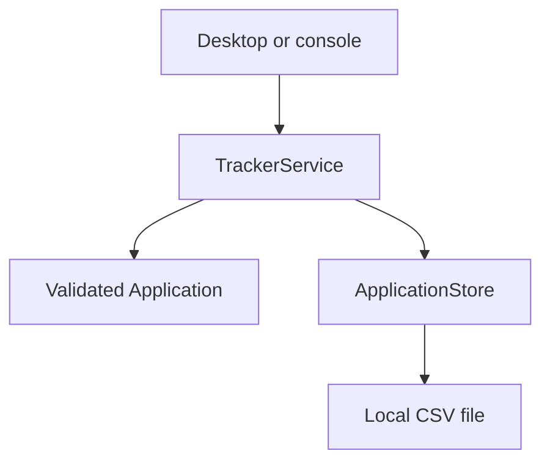

# ApplyTrack Java

A small Java desktop and command-line application for tracking internship and job applications. Store company, role, application date, status, follow-up date and notes locally, then see which follow-ups are due.

## Features

- Add an application and update its status, notes and follow-up date.
- Desktop table with sorting, selection and a due-by-today filter.
- Equivalent console commands for repeatable demos and testing.
- CSV persistence across restarts, including quoted commas, quotes and Unicode.
- Reject invalid dates, duplicate IDs and corrupt files instead of silently overwriting data.
- Save to a temporary file before replacing the data file; use atomic replacement when the filesystem supports it.
- Status counts and date-ordered follow-ups. OFFER, REJECTED and WITHDRAWN are treated as closed.

## Quick start on Windows

Requires a JDK 8 or newer. No Maven, database server, internet connection or external Java dependencies are needed.

1. Extract the downloaded project ZIP completely.
2. In that folder, open PowerShell and run `java -version` and `javac -version`.
3. Run `.\build.bat` to compile, run the tests and create `applytrack.jar`.
4. Run `.\run.bat` to open the desktop. Build first when using GitHub source. The separate interview download includes a prebuilt JAR; binaries are not committed here.
5. Add a fictional company, close the app, reopen it, and verify the row remains.

PowerShell console demo (read-only sample):

```powershell
java -jar applytrack.jar --data samples/applications.csv list
java -jar applytrack.jar --data samples/applications.csv due 2026-11-24
java -jar applytrack.jar --data samples/applications.csv summary
```

Create your own records separately:

```powershell
java -jar applytrack.jar add "Demo Company" "Java Intern" 2026-11-18 2026-11-24 "Prepare technical interview"
java -jar applytrack.jar update 1 INTERVIEW 2026-11-24 "Review OOP and collections"
java -jar applytrack.jar list
```

`update` requires replacement notes and a follow-up date; use `-` to clear the date. Dates use YYYY-MM-DD. Quote arguments containing spaces. There is no automatic emailing or scheduled reminder service. The due list is shown when you open or refresh the app.

On Linux/macOS: `sh build.sh`, then `java -jar applytrack.jar`. A graphical desktop is needed for the GUI; console commands work headlessly.

## Design



| Class | Responsibility |
|---|---|
| `Application` | Immutable validated record and due-date rule |
| `Status` | Fixed set of statuses and closed-status rule |
| `TrackerService` | Add, update, due list and summary operations |
| `ApplicationStore` | Read and safely replace CSV data |
| `Csv` | Single-line CSV quoting and parsing |
| `TrackerFrame` / `Main` | Desktop and console interaction |

For n records, loading, adding, updating and summary computation take O(n); sorting the due list takes O(n log n) in the worst case. Memory use is O(n). These are algorithmic bounds, not measured performance claims.

## Tests

`build.sh` or `build.bat` runs the dependency-free Java test runner. Tests use temporary directories and do not change your application data. Coverage includes restart persistence, quoted text, invalid dates, duplicate IDs, failed updates, corrupt-file protection, summary totals and due-date boundaries. See `TEST_RESULTS.md` for the locally verified environment and results.

## Limits and next steps

This is a single-user learning project. Run only one instance against a file; concurrent writers are not coordinated. CSV fields must stay on one line. Files are not encrypted. Do not commit real application notes or personal contact data: `data/` is ignored by Git. The project does not include authentication, cloud sync, a database or background notifications. Future work could add SQLite transactions, search and edit-history tracking.

## Project provenance

Created in November 2026 as an AI-assisted Java portfolio project for Sandhya L D. The implementation and tests are available for review. See `INTERVIEW_GUIDE.md` to trace the code and practise explaining its decisions. The sample companies are fictional.
