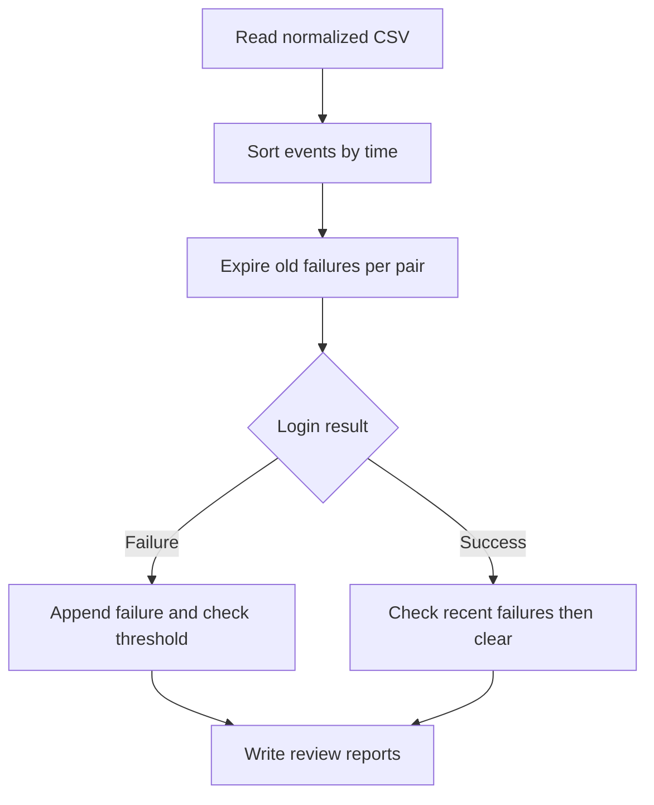

# AuthLog Analyzer Java

A local Java command-line tool that finds repeated failed logins and a successful login following a burst of failures in a normalized authentication CSV. It produces an HTML report, an alert CSV and a malformed-row report.

## What it does

- Parses timestamps with timezone information and sorts events chronologically.
- Maintains an independent sliding window for each `(source, user)` pair using a HashMap and ArrayDeque.
- Flags a threshold of failed logins within a configurable time window.
- Flags a subsequent success only if that same pair still has enough recent failures.
- Suppresses repeat alerts during a continuous burst and resets after success or expiry below the threshold.
- Skips malformed data rows with line numbers; rejects a missing or incorrect header.
- Escapes untrusted text in HTML and neutralizes formula-like identifiers in the exported CSV.

These are transparent heuristics. An alert is a review signal, not proof of an attack. This project does not use machine learning and has no measured accuracy claim.

## Run on Windows

Requires JDK 8 or newer, with no external Java dependencies.

1. Extract the ZIP completely.
2. Open PowerShell in the extracted folder.
3. Run `.\build.bat` to compile and execute the tests.
4. Run `java -jar authlog-analyzer.jar` to process the included synthetic sample.
5. Open `output\report.html` in a browser.

Build first when using GitHub source. The separate interview download includes a prebuilt JAR. Source control excludes build output. On Linux/macOS run `sh build.sh`, then the same Java command.

Custom thresholds:

```powershell
java -jar authlog-analyzer.jar samples/login-events.csv output 5 300
```

Arguments are input file, output directory, failure threshold (at least 2), and window seconds (1 to 86400). Defaults are 5 failures in 300 seconds. Running again replaces the three report files in the chosen output directory.

Input format:

```csv
timestamp,source,user,result
2026-11-18T09:00:00Z,192.0.2.10,learner,FAILURE
```

Use ISO 8601 timestamps with an offset (for example `Z` or `+05:30`), and SUCCESS or FAILURE. Source is an opaque label, not a DNS-validated IP address. Convert real system logs to this schema first. Quoted commas/quotes are supported, but multiline fields are not. The exact header is required; a UTF-8 BOM on that header is accepted.

## Expected sample result

The fictional sample contains 9 valid events and 1 malformed row. With default settings it produces 2 alerts: REPEATED_FAILURES and SUCCESS_AFTER_FAILURES. The addresses are documentation examples. No network traffic is generated or collected.

## Algorithm



An event at exactly `current time - window` remains inside the window. Each failure enters and leaves its deque at most once. Sorting costs O(n log n); processing after sorting is O(n) expected using hash lookup. The batch implementation stores all valid events and can use O(n) memory. Equal timestamps retain input order.

## Code map

| Class | Responsibility |
|---|---|
| `LoginEvent` | Normalized event |
| `LogReader` | Schema validation, parsing and rejected-row diagnostics |
| `Analyzer` | Sorting, per-pair windows and alert decisions |
| `Alert` | Evidence for a rule match |
| `ReportWriter` | HTML, CSV and warning output |
| `Main` | Arguments and workflow |

## Verification and limitations

Run `build.bat` or `sh build.sh`. Tests cover exact and fractional time boundaries, success resets, separated users/sources, out-of-order input, repeat suppression, malformed rows and safe report output. See `TEST_RESULTS.md` for observed results.

This is an offline batch tool, not a SIEM, intrusion prevention system or production monitor. A wrong password burst can be legitimate. Distributed attempts across sources and attacks that stay below the threshold may be missed. Shared addresses can affect interpretation. Duplicate input records are counted, not deduplicated. Only the first 100 invalid-row details are retained, while the total count is reported. It does not block users, send alerts or calculate attack-chain reconstruction accuracy.

## Project provenance

Created in November 2026 as an AI-assisted Java portfolio project for Sandhya L D. Sample data is synthetic. See `INTERVIEW_GUIDE.md` for an explanation and a traceable demo. This project is separate from the ongoing MCA attack-chain research.
